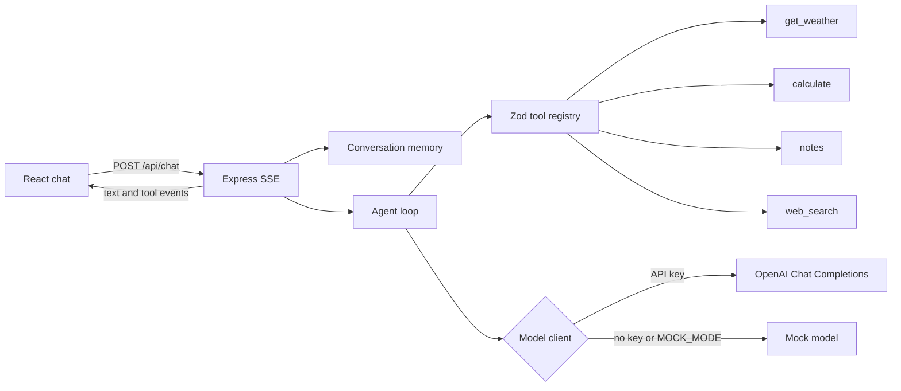

# AI Assistant Demo

[](https://github.com/faheemdev78/ai-assistant-demo/actions/workflows/ci.yml)
[](https://nodejs.org/)
[](https://www.typescriptlang.org/)
[](LICENSE)

A streaming, tool-using chat assistant. The Express API calls the official OpenAI SDK when `OPENAI_API_KEY` is set, and a deterministic mock model when it is not, so the demo runs with no secrets. A small React UI renders tokens as they arrive and shows each tool call beside the reply.

Conversations and notes live in process memory. Restarting the server clears them.

## Features

- Server-sent events for token deltas, tool calls, tool results, and completion
- Four tools with Zod schemas converted to JSON Schema for the model: mocked weather, a safe arithmetic parser, in-memory notes, and a search stub
- An agent loop that executes tool calls and sends the results back to the model, with a step limit
- The same loop for live Chat Completions and for mock mode
- Conversation history kept per id and returned to the UI after a refresh
- Vitest coverage for the tools, stream assembly, agent loop, and the HTTP API
- GitHub Actions for lint, formatting, typecheck, and tests
- A multi-stage Docker image and Compose file

## Architecture



One turn:

1. The UI posts a message. The server opens or resumes a conversation and appends the user message.
2. The model client streams either text or one or more function calls.
3. Text deltas are forwarded as SSE immediately.
4. Each call is validated with Zod and executed. The result is stored as a tool message and emitted as `tool_result`.
5. The loop asks the model again with that result, up to four steps, then closes the stream.

The calculator is a small recursive-descent parser. It never uses `eval`. Weather and search do not call the network.

## Quick start

Requires Node.js 22 or newer.

```bash
cp .env.example .env
npm install
npm run dev
```

Open [http://localhost:5173](http://localhost:5173). The Vite server proxies `/api` to the API on port 3001.

Leave `OPENAI_API_KEY` empty. The health check reports `mock`, and the suggestion chips exercise all four tools.

To use OpenAI, set a key in `.env` and restart:

```bash
OPENAI_API_KEY=sk-...
OPENAI_MODEL=gpt-4o-mini
```

`MOCK_MODE=true` forces the scripted model even if a key is present. `MOCK_MODE=false` fails fast when the key is missing.

### Docker

```bash
docker compose up --build
```

The app listens on [http://localhost:3001](http://localhost:3001) and serves the built UI from the same origin. Pass a key without writing it into the image:

```bash
OPENAI_API_KEY=sk-... docker compose up --build
```

## Configuration

| Variable         | Default       | Purpose                                                 |
| ---------------- | ------------- | ------------------------------------------------------- |
| `OPENAI_API_KEY` | empty         | Enables live Chat Completions. Read only on the server. |
| `OPENAI_MODEL`   | `gpt-4o-mini` | Model id when live mode is on.                          |
| `MOCK_MODE`      | unset         | `true` forces mock mode. `false` requires a key.        |
| `PORT`           | `3001`        | API port.                                               |

`.env.example` lists the same variables. `.env` is gitignored.

## HTTP API

| Method   | Path                     | Description                                      |
| -------- | ------------------------ | ------------------------------------------------ |
| `GET`    | `/api/health`            | `{ ok, mode, model }`                            |
| `GET`    | `/api/tools`             | Tool names and descriptions                      |
| `POST`   | `/api/chat`              | SSE stream. Body: `{ message, conversationId? }` |
| `GET`    | `/api/conversations/:id` | Stored messages, without the system prompt       |
| `DELETE` | `/api/conversations/:id` | Drop one conversation                            |

`POST /api/chat` events:

| Event         | Payload                    |
| ------------- | -------------------------- |
| `meta`        | `{ conversationId, mode }` |
| `text`        | `{ delta }`                |
| `tool_call`   | `{ id, name, arguments }`  |
| `tool_result` | `{ id, name, ok, result }` |
| `done`        | `{ finishReason }`         |
| `error`       | `{ message }`              |

Example:

```bash
curl -N -X POST http://localhost:3001/api/chat \
  -H 'Content-Type: application/json' \
  -d '{"message":"What'\''s the weather in Lisbon?"}'
```

## Tools

| Tool          | Input                       | Behavior                                              |
| ------------- | --------------------------- | ----------------------------------------------------- |
| `get_weather` | `location`, optional `unit` | Deterministic mock forecast from the location string  |
| `calculate`   | `expression`                | `+ - * /`, parentheses, decimals, unary minus         |
| `notes`       | `action` plus fields        | `create`, `list`, `get`, `update`, `delete` in memory |
| `web_search`  | `query`, optional `limit`   | Up to five stub results on `example.com`              |

Mock mode routes plain sentences such as “weather in Lisbon”, “calculate (18 * 4) / 3”, “save a note: …”, and “search for …”. Live mode lets the model choose the tool from the JSON Schema.

## Scripts

| Command             | What it does                                    |
| ------------------- | ----------------------------------------------- |
| `npm run dev`       | API with `tsx` watch, and the Vite UI           |
| `npm run build`     | Compile the server and build the UI             |
| `npm start`         | Serve `server/dist` and, if present, `web/dist` |
| `npm test`          | Vitest                                          |
| `npm run lint`      | ESLint                                          |
| `npm run format`    | Prettier                                        |
| `npm run typecheck` | `tsc --noEmit` in both packages                 |

## Project layout

```text
server/src
  agent/        loop, OpenAI stream adapter, mock model
  http/         Express app and SSE
  memory/       conversation store
  tools/        Zod tools and the registry
web/src         React chat
server/test     Vitest
```

## Tests

`npm test` does not call OpenAI. The stream adapter is fed fake Chat Completions chunks, and the agent loop is driven by a scripted client plus the mock model. Tool tests cover schema rejection, arithmetic edge cases, notes CRUD, and the search stub. An HTTP test boots the app on an ephemeral port and reads the SSE body.

## License

[MIT](LICENSE)
